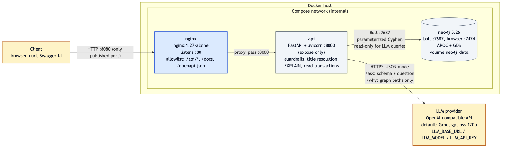
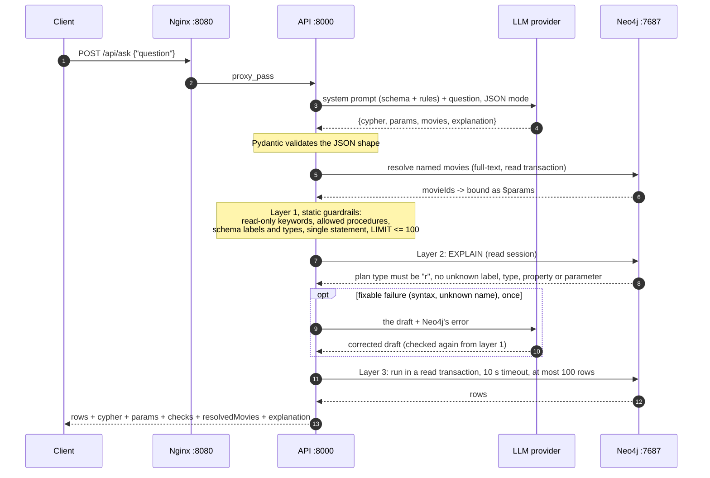
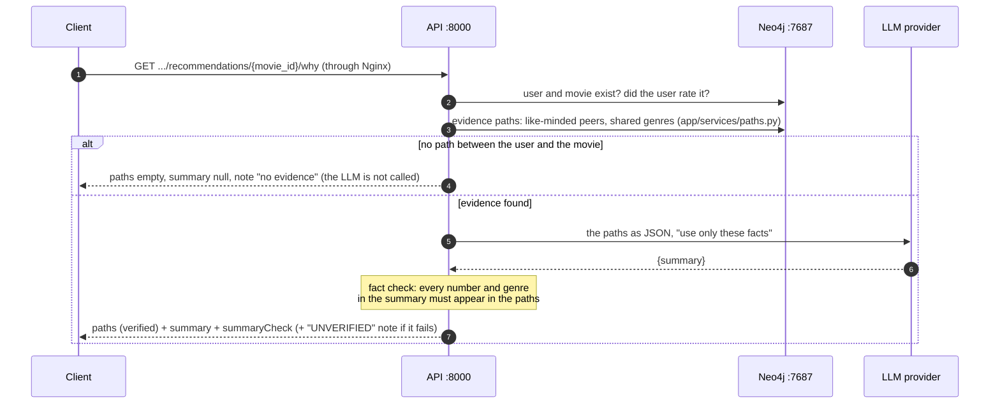

# System architecture

Services, ports and data flows of the Compose stack (`docker-compose.yml`), with the two LLM request flows in detail.



Source: [`architecture.mmd`](architecture.mmd) (Mermaid). Regenerate the PNG with:

```bash
npx -y @mermaid-js/mermaid-cli@11.4.2 -i docs/architecture.mmd -o docs/architecture.png -b white -s 2
```

## Services and ports

| Service | Image | Port | Published on the host | Role |
|---|---|---|---|---|
| `nginx` | `nginx:1.27-alpine` | 80 | **8080** (the only one) | reverse proxy; forwards `/api/*`, `/docs`, `/openapi.json`, everything else 404s at the proxy |
| `api` | built from `Dockerfile` (uv, Python 3.12) | 8000 | no (`expose` only) | FastAPI endpoints, guardrails, title resolution, LLM calls |
| `neo4j` | `neo4j:5.26` with APOC and GDS | 7687 (Bolt), 7474 (browser) | no; `docker-compose.dev.yml` publishes them for development | graph store, volume `neo4j_data` |
| LLM provider | external (default Groq) | 443 | n/a: outbound HTTPS from `api` | writes Cypher drafts and why-summaries |

Access control is by topology: a client can only reach Nginx, and Nginx only forwards the allowlisted paths. Neo4j is never reachable from outside the Compose network. `tests/test_container_health.py` checks both properties on a running stack (`STACK_URL=http://localhost:8080`).

Configuration comes from `.env` (never committed; see `.env.example`): `NEO4J_PASSWORD` for the stack, and `LLM_BASE_URL`, `LLM_MODEL`, `LLM_API_KEY` for the LLM. Without `LLM_API_KEY`, `/api/ask` answers 503 and every other endpoint works. `/why` still returns its graph paths, with no summary.

## Flow of `POST /api/ask`



Status codes: 200 (answered, or `answered: false` when the model declines or a named movie is not in the graph), 400 (a layer rejected the draft; the body lists every check), 422 (invalid question), 502 (LLM failed or answered off-schema), 503 (no LLM configured, or database down), 504 (query timeout). Every rejected draft is logged with its failed checks, including drafts a retry later fixed.

## Flow of `GET /api/users/{id}/recommendations/{movie_id}/why`



The paths are the explanation; the summary is an optional rewording of them. Without an LLM, or when the provider fails, the endpoint still answers 200 with the paths.
