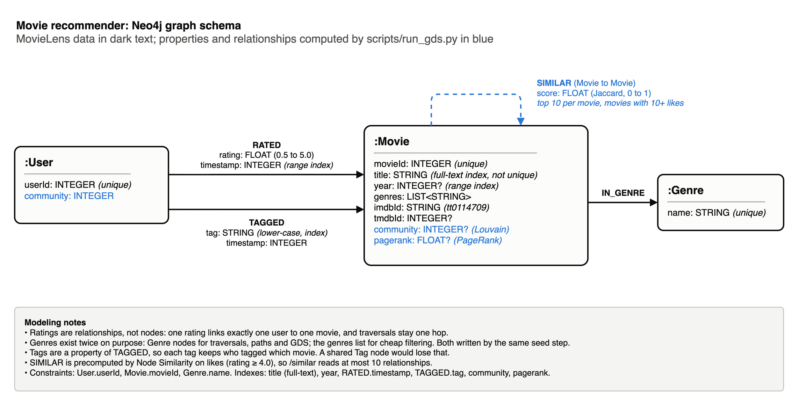

# Modeling rationale

Why the graph looks the way it does, which alternatives were rejected, and why each graph algorithm was chosen. The evidence (distributions, experiments) is in `demo.ipynb`; the query-level contract for the API is in `docs/decisions.md`.

Source: [`graph_schema.drawio`](graph_schema.drawio) (open with draw.io or app.diagrams.net).

## The use case as a graph

A recommender answers questions about *people who behave alike* and *items liked by the same people*. Both are two-hop patterns over a user–movie bipartite graph: user → movie ← user for neighbours, movie ← user → movie for co-liked items. Everything else in the schema (genres, tags, precomputed similarity, communities) either shortens those paths or explains them.

| Label | Count (ml-latest-small) | Why it is a node |
|---|---|---|
| `User` | 610 | the subject of recommendations; needs identity and its own relationships |
| `Movie` | 9,742 | the object of every relationship; carries the GDS results |
| `Genre` | 19 | shared by thousands of movies; traversed for "shares a genre" paths and explanations |

## Decisions and rejected alternatives

### Ratings are relationships, not nodes

`(:User)-[:RATED {rating, timestamp}]->(:Movie)`.

* **Rejected: `(:User)-[:GAVE]->(:Rating {value, timestamp})-[:FOR]->(:Movie)`.** It doubles every traversal (two hops per rating), adds 100,836 nodes (25 million on ml-25m), and gains nothing: a MovieLens rating has no relationships of its own. A Rating node would be justified if ratings had their own connections (a review text with comments, a moderation status), which they do not.
* Fewer than 2% of user–movie pairs are rated (notebook 1.1), so storing only existing pairs as relationships is also the compact choice.

### Genres are nodes *and* a list property

`(:Movie)-[:IN_GENRE]->(:Genre)` plus `Movie.genres: LIST<STRING>`.

* **Nodes only (rejected):** checking "is this movie a comedy?" inside a recommendation query means an extra expansion per candidate.
* **Property only (rejected):** "movies sharing a genre with what you liked" becomes list intersection with no index help, the "why" endpoint has no genre node to put in a path, and GDS cannot traverse a list.
* **Both (kept):** filters read the list; paths, explanations and GDS use the nodes. The duplication is written by one `MERGE` statement in the seed script (the list and the relationships come from the same parsed row), so they cannot drift apart; an integration test checks they agree.
* **Supernode caveat:** `Drama` is linked to 4,361 movies. Queries must enter a Genre from a movie and filter, never expand a Genre to all of its movies unbounded.
* `(no genres listed)` is a placeholder, not a genre: it creates no node and leaves an empty list. `IMAX` is a screening format but is kept as MovieLens defines it, and documented.

### Tags are a relationship property, not Tag nodes

`(:User)-[:TAGGED {tag, timestamp}]->(:Movie)`.

* **Rejected: `(:User)-[:TAGGED]->(:Tag)-[:TAG_OF]->(:Movie)`.** Once a Tag node is shared, the triple *who tagged which movie with what* is lost: from "user 474 used *pixar*" and "*pixar* is a tag of Toy Story and Up", you cannot tell which movie user 474 tagged.
* **Rejected: a reified `(:TagApplication)` node.** Correct, but one node per tag for a feature used by 58 of 610 users.
* Tags are lower-cased (1,589 raw values collapse to 1,475) and indexed, so "movies tagged X" is an index lookup.

### Year is a property, not a node

A `(:Year)` node would only support "movies from 1995", which a range index on `Movie.year` already answers, including ranges such as the 1990s. Year nodes would add 100+ nodes and a hop without enabling any new traversal.

### Identity and titles

* `movieId` and `userId` are the only keys (integers, uniqueness constraints).
* **Titles are not unique:** five titles are shared by different films with different IMDb ids (two *Emma (1996)*, two *War of the Worlds (2005)*). A uniqueness constraint on `title` would reject real data; title lookups go through a full-text index and may return several movies.
* Titles are cleaned for people and for the LLM: year moved to its own property, article moved back to the front (`Matrix, The (1999)` becomes `The Matrix`, 1999).
* `imdbId` is stored in IMDb's own format (`tt0114709`) because that is how users and the LLM will write it.

### `SIMILAR` is precomputed

* **Rejected: computing similarity at request time** with a co-rating query. For a popular movie that means visiting every user who liked it and every movie those users liked, which grows with the square of the movie's audience, on every request.
* **Kept:** Node Similarity writes each movie's 10 nearest neighbours once. The graph grows by at most 10 relationships per movie, and `/similar` reads at most 10 relationships.
* **Trade-off:** results are as fresh as the last `run_gds` run, and movies with fewer than 10 likes have no `SIMILAR`; the API falls back to a co-rating query for them.
* **Direction:** `(a)-[:SIMILAR]->(b)` means *b is among a's top 10*. That relation is not symmetric, so the relationship is directed.

### Communities and PageRank are properties

`Movie.community`, `Movie.pagerank`, `User.community` are written as indexed properties.

* **Rejected: `(:Community)` nodes** with `IN_COMMUNITY` relationships. Useful if communities had their own attributes (a name, a description); here a community is only an id, and "movies in the same community" is an indexed equality lookup.
* `User.community` is derived after Louvain: the community most of the user's liked movies belong to. This is what the `discover` endpoint starts from.

## Algorithm choices

| Need | Chosen | Alternatives considered | Why |
|---|---|---|---|
| Movie–movie similarity | **Node Similarity, Jaccard**, on likes only (rating ≥ 4.0) | cosine on rating vectors; kNN on embeddings | "People who liked X also liked Y" is exactly Jaccard on sets of likers, and it is explainable: the score is shared likers over all likers, which the "why" endpoint can state. Counting low ratings would make two movies similar because the same people disliked both. |
| Similarity cutoff | **at least 10 likes** | 5, 20 | At 5, movies liked by 9 people became hubs listed as "similar" by 40+ movies (PageRank uncorrelated with popularity, rank correlation 0.08). At 10 the hubs disappear (0.32) and 74% of likes are still covered; 20 halves the catalogue again. Notebook 3.1. |
| Communities | **Louvain**, weighted by score | Label Propagation; Leiden | Louvain maximises modularity on weighted graphs and, run single-threaded on an ordered projection, is reproducible. Label Propagation is fast but unstable on dense graphs. Leiden fixes Louvain's occasional badly connected communities and is the natural upgrade; Louvain was kept because it is the technique the brief names and its modularity (0.57) already shows clear structure. |
| Centrality | **PageRank**, weighted by score | in-degree; betweenness | In-degree counts how many top-10 lists include a movie; PageRank also weighs *which* movies list it. Betweenness answers "who bridges clusters", not "who is central", and is far more expensive. |
| Link prediction | **FastRP + logistic regression**, temporal split | GDS link prediction pipeline; node2vec | The GDS pipeline splits relationships at random, which cannot respect a split in time. FastRP is fast, deterministic with a seed, and needs no tuning. Notebook section 4. |

## How the costs grow

| Operation | Cost driver | How it is bounded |
|---|---|---|
| Seeding | number of ratings | batched `UNWIND` (5,000 rows per transaction), `MERGE` on uniqueness constraints (index lookups, not scans) |
| Node Similarity | pairs of movies sharing likers | `degreeCutoff` 10 and `topK` 10: output is at most 10 relationships per movie |
| Louvain, PageRank | size of the `SIMILAR` graph | runs on about 10 × (movies with 10+ likes) relationships, not on the ratings |
| `/similar` | `SIMILAR` degree | at most 10 relationships, read through the movieId constraint |
| Genre traversals | genre size (Drama: 4,361 movies) | always entered from a movie and filtered; never expanded unbounded |

### Measured at scale

Timings on the laptop development setup (Neo4j 5.26 in Docker, 1 GB heap), for the 5% user sample of `ml-25m`:

| Step | Input | Time | Output |
|---|---|---|---|
| `seed_data --sample-users 0.05` | 8,127 users, 62,423 movies, 1,265,960 ratings, 39,166 tags | 37 s | the full graph |
| `run_gds` | 635,826 likes | 160 s | 52,660 `SIMILAR`, 15 communities (modularity 0.68) |
| `link_prediction` | 1,012,767 training ratings | 28 s | evaluation on 296 returning users |

For comparison, `ml-latest-small` (100,836 ratings) seeds in about 3 s and runs GDS in about 4 s.

### Known limitation: the similarity cutoff does not scale by itself

The cutoff of 10 likes was chosen on `ml-latest-small` (610 users). On the `ml-25m` sample (13 times more users) the overall PageRank ranking is still sensible (*The Empire Strikes Back*, *The Matrix*, *Raiders of the Lost Ark*), but the most central movies of some communities are obscure titles again: 10 likes is a lower bar when there are more users. The cutoff should grow with the number of users (for example as a fraction of them), and be re-checked with the diagnostics of notebook section 3.1 on each new dataset.

